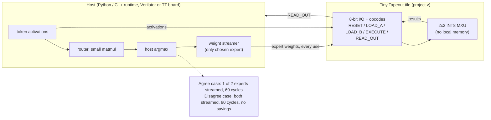

# 01 — Tiny Tapeout 2x2 MXU, host-streamed MoE (current silicon baseline)

Source: `CHIPFOUNDRY_MOE_PLAN.md` ("What's already proven"), `CHAT_RECAP.md`.
No on-chip memory, no ISA change. The host does routing and streams only the chosen expert's weights.
`MOE_ATTENTION_ROADMAP.md` is referenced by the plan but was not in the folder, so this is built from the plan's description of it.

