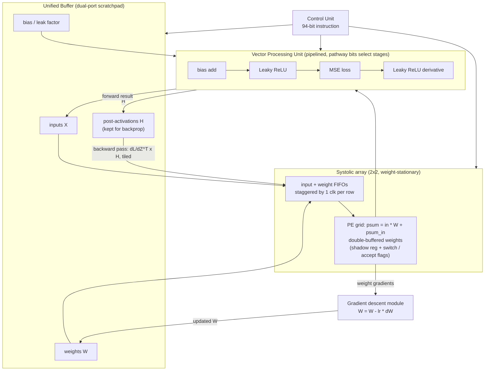

# 02 — tiny-tpu (XOR inference + training)

Source: `tiny-tpu/README.md`, `TINY_TPU_BLOG.md`.
Weight-stationary systolic array, 94-bit ISA, trains a 2→2→1 MLP. The design is derived from the layer math (bias, activation, loss, derivative).

Takeaway for us: forward and backward both use the same matmul array. Everything non-matmul sits in a streaming VPU behind it.
