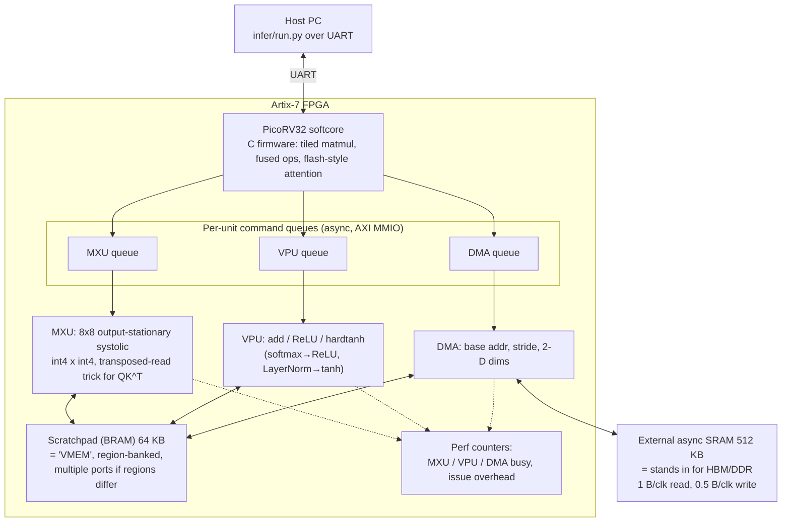

# 03 — transformer-tpu-int4 (FPGA, Cmod A7-35T)

Source: `transformer-tpu-int4/README.md`, `writeup/writeup.md`.
Model: decoder-only int4 adder, d=128, d_ff=512, 4 layers, 4 heads. Prefill then decode with a KV cache.

Measured (12 MHz): prefill-only 64 tokens ≈ 249 ms (fused + double-buffered). Prefill+decode ≈ 4.06 s.
Decode is over 90% of total time, and DMA-bound by weight loads.
