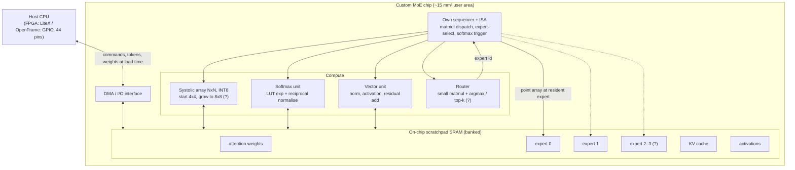

# 04 — ChipFoundry-scale quantized MoE (the plan's draft target)

Source: `CHIPFOUNDRY_MOE_PLAN.md`. Draft, open to revision. Blocks marked (?) are open questions in the plan.

Differences from #01: the experts stay resident and nothing is re-streamed. Softmax is real, in hardware. The sequencer is on chip.
Open: whether the routing decision stays host-side or on chip (the plan lists this as open).
