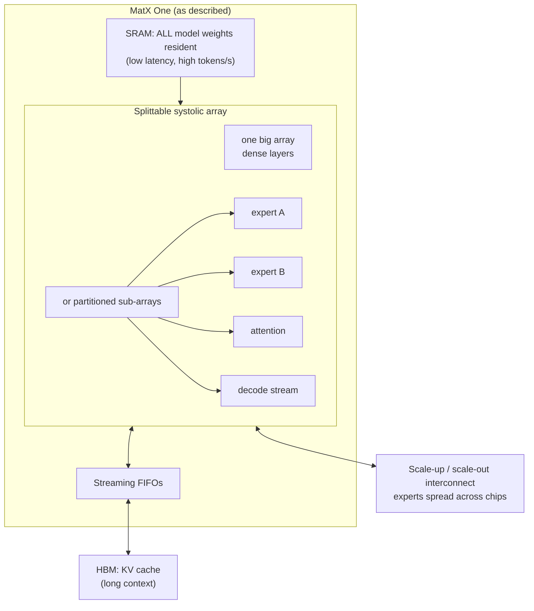

# 05 — MatX One style (aspirational reference, from INSPO.md)

Source: `INSPO.md` chat transcript. These claims come from an AI chat plus MatX's public statements. They are **unverified** and MatX has published no microarchitecture paper (per the chat itself).
Use it for the idea only: splittable array, weights in SRAM, KV cache in bulk memory.

What we take from it at our scale: the weights-in-SRAM and KV-elsewhere split, and the array that can be partitioned per expert.
We drop HBM and the multi-chip interconnect, since we are one small die.
