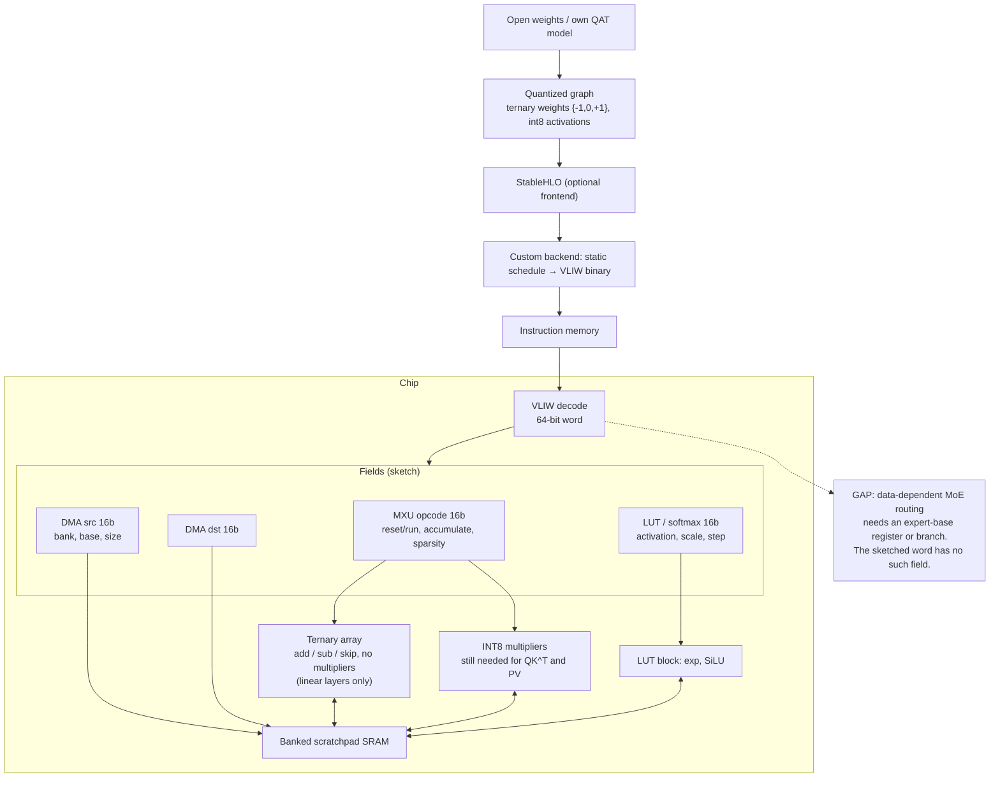

# 06 — Ternary (BitNet b1.58) + static VLIW + StableHLO variant (from INSPO.md addendum)

Source: the "Software Map" section added to `INSPO.md`. The VLIW layout is a sketch from that chat and has gaps, which are marked below.

