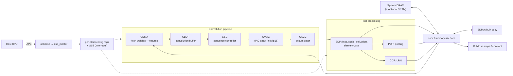

# 07 — NVDLA (reference only)

Source: `NVDLA_fork/hw/vmod/nvdla/` directory names (cdma, cbuf, csc, cmac, cacc, sdp, pdp, cdp, rubik, bdma, glb, csb_master, apb2csb, nocif).
Roles are from my knowledge of NVDLA and I have not read the RTL. It is conv-oriented and has no attention or softmax path.

Reusable ideas: the fetch → buffer → sequence → MAC → accumulate → post-process split, the register-programmed layer descriptors, and keeping the post-ops after the accumulator (same idea as tiny-tpu's VPU).
Not reusable as a base: the convolution-specific buffer and sequencer, and the size.
