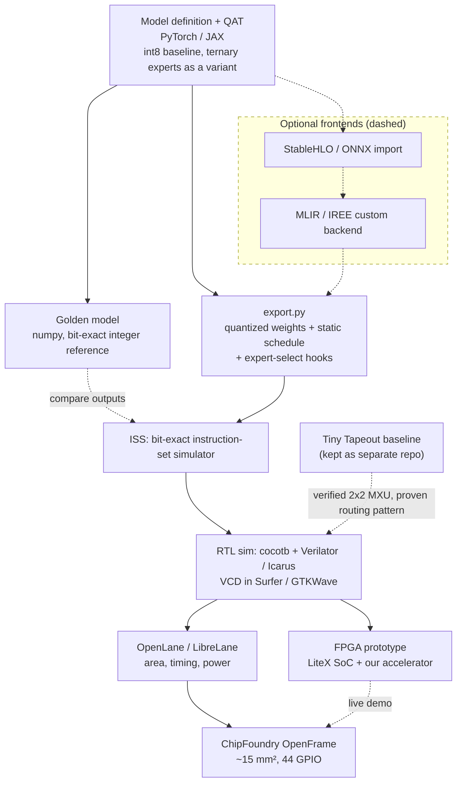

# 08 — Software toolchain and platform path (agreed pipeline + open-source options)

Source: `CHAT_RECAP.md` (platform path), `GUIDE_2.md`, plus the StableHLO idea in INSPO. Items in dashed boxes are optional or proposed.

Every arrow into the ISS or RTL is checked bit-for-bit against the golden model. This is the `transformer-tpu-int4` test-suite pattern, with `-b iss`, `-b rtl` and `-b board` as the backends.
