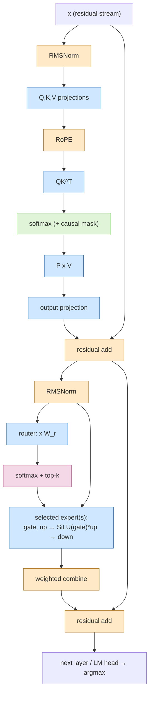
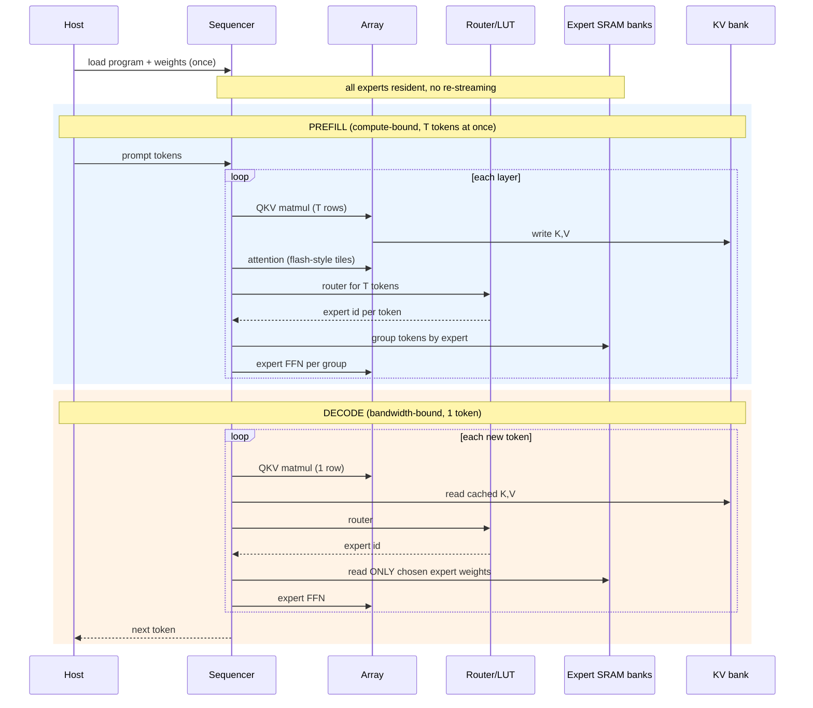

# 09 — MoE transformer block → hardware unit map, and prefill/decode flow

Method borrowed from `TINY_TPU_BLOG.md`: write the layer math, then give every operation a unit.
Block style is Qwen3-MoE-like (RMSNorm, RoPE, GQA, softmax attention, SwiGLU experts, top-k router) so the op set scales to real models.
Only the first two are in the int4 project. The others are what we add.

## Op → unit

Legend: blue = systolic array (matmul), orange = vector unit, green = LUT (exp / reciprocal / rsqrt / SiLU), pink = sequencer decision (expert select).

| Op | Unit | Notes |
|---|---|---|
| Q,K,V,O, router, expert gate/up/down | array | about 90% of MACs. Reads weights from SRAM. |
| QKᵀ | array | read K transposed, as in the int4 MXU (no physical transpose) |
| softmax | LUT unit | max-subtract, exp LUT, sum, reciprocal LUT. The int4 project avoided it by using ReLU. |
| RMSNorm | vector + rsqrt LUT | int4 project used tanh-norm |
| RoPE | vector | sin/cos table in ROM |
| SiLU | LUT | shares the exp LUT |
| top-k | sequencer | writes expert-base register, then dispatches |

## Prefill vs decode with expert residency

In decode the weight read dominates (the int4 project measured DMA at 3–4x MXU time). Because an MoE reads only the chosen experts, it cuts weight traffic per token. This is the actual specialization advantage.
